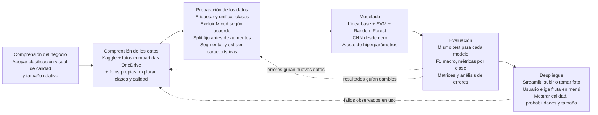

# Formulación matemática y CRISP-DM

> Borrador para el informe. Completar o ajustar los valores de partición, resultados y nombres de modelos con las decisiones y artefactos finales del equipo. No se deben inventar métricas.

## Formulación del problema

El sistema recibe una fotografía RGB `x` que contiene una sola fruta y el tipo de fruta `f`, elegido por el usuario en la interfaz. Produce dos salidas: (1) una categoría de calidad `y` —mala, regular o buena— con sus probabilidades estimadas y (2) un tamaño relativo `z` —pequeño, mediano o grande—. El tipo de fruta se selecciona en el menú; el sistema no pretende reconocer la especie automáticamente.

Sea `x ∈ [0,255]^(H×W×3)` una imagen y `S(x)` la máscara binaria estimada por el proceso de segmentación. A partir de los píxeles segmentados se calcula un vector de 69 características:

$$
\phi(x,S(x)) = [\phi_{HSV},\,\phi_{LBP},\,\phi_{forma}] \in \mathbb{R}^{69}.
$$

El vector reúne histogramas y estadísticas de color HSV, un histograma LBP de textura y medidas geométricas de la máscara. Para calidad, dado un conjunto de entrenamiento `D_train = {(x_i,y_i)}`, se aprende un clasificador `h_θ` que estima una probabilidad por clase:

$$
\hat{p}_θ(y=k\mid x) = h_θ(\phi(x,S(x)))_k,\qquad
\hat{y} = \arg\max_{k\in\{\text{mala, regular, buena}\}} \hat{p}_θ(y=k\mid x).
$$

La salida de tamaño se calcula a partir del área `A(x)` de la máscara. El diámetro equivalente normalizado es:

$$
d(x)=\frac{2\sqrt{A(x)/\pi}}{\max(H,W)}.
$$

Para cada tipo `f`, se calibran dos umbrales `t_{f,1}` y `t_{f,2}` con los percentiles 33,3 y 66,7 de los diámetros de las imágenes de entrenamiento de esa fruta. La predicción es:

$$
\hat{z}(x,f)=
\begin{cases}
\text{pequeño}, & d(x)<t_{f,1},\\
\text{mediano}, & t_{f,1}\le d(x)<t_{f,2},\\
\text{grande}, & d(x)\ge t_{f,2}.
\end{cases}
$$

Este tamaño es relativo al encuadre y a las frutas de referencia del mismo tipo; no es una medición física en centímetros. La distancia de captura debe mantenerse aproximadamente constante. Los umbrales se calculan solo con entrenamiento para evitar usar el conjunto de prueba durante la calibración.

## Estrategia y evaluación

Se compararán una línea base y dos clasificadores clásicos, por ejemplo SVM y Random Forest. La búsqueda de hiperparámetros se realiza únicamente dentro de entrenamiento mediante validación cruzada. Se seleccionan los hiperparámetros `λ` que maximizan el F1 macro promedio:

$$
\lambda^*=\arg\max_{\lambda\in\Lambda}\frac{1}{K}\sum_{j=1}^{K}
F1_{macro}(y_j,\hat{y}_{j,\lambda}).
$$

El F1 macro da el mismo peso a cada clase, por lo que ayuda cuando hay desbalance. La comparación final se hace una sola vez e incluye accuracy, F1 macro, precisión y recall por clase y matriz de confusión. Los modelos clásicos se evaluaron con 4.112 imágenes de prueba; la CNN, con 4.194. También se reportan resultados por fuente de imágenes si el split compartido conserva esa información. La CNN se añade a esa comparación con las mismas etiquetas y partición.

Para que la interfaz muestre probabilidades del SVM, su entrenamiento debe habilitar `probability=True` o calibrar el clasificador con `CalibratedClassifierCV`; no se debe presentar como probabilidad una puntuación sin calibrar.

El problema es de ingeniería porque combina imágenes con variación de iluminación, fondo, cámara, variedad de fruta y defectos; las clases pueden estar desbalanceadas; y la predicción debe integrarse en una interfaz con límites claros de uso. La segmentación puede fallar y las características visuales no reemplazan inspección sanitaria.

## Diagrama CRISP-DM del proyecto

El SVG es la versión lista para insertar en el informe. El Mermaid de abajo sirve como fuente editable.

### Qué evidencia documentar en cada fase

1. **Comprensión del negocio:** quién usaría la herramienta, qué decisión apoya y por qué la categoría de calidad y el tamaño relativo son útiles.
2. **Comprensión de los datos:** conteos por clase y fuente, imágenes representativas, desbalance, variaciones de iluminación/fondo y límites de las etiquetas.
3. **Preparación:** definición de clases, tratamiento de Mixed, fotos propias y compartidas, semilla y partición acordadas, aumento solo en entrenamiento, segmentación y características.
4. **Modelado:** línea base, SVM, Random Forest y CNN; rangos de hiperparámetros, validación cruzada y justificación matemática.
5. **Evaluación:** resultados reales en el test común, matrices de confusión, errores típicos y comparación entre fuentes. Dejar esta sección pendiente hasta entrenar y evaluar.
6. **Despliegue:** flujo de la interfaz, menú de fruta, entrada por archivo/cámara, contrato de predicción, límites, privacidad y aviso de que el tamaño es relativo.

## Confirmaciones antes de cerrar el informe

- Confirmar con Samuel el archivo de partición y sus proporciones/semilla; usar exactamente el mismo split en ML y CNN.
- Acordar el mapeo único de etiquetas entre `Bad/Regular/Good` y sus índices numéricos.
- Mantener el menú de fruta elegido por el usuario como entrada de la función de predicción y para seleccionar los umbrales de tamaño.
- Sustituir los ejemplos de modelos por los modelos que efectivamente entrenen y agregar únicamente métricas calculadas.
- Añadir referencias bibliográficas para GrabCut, LBP y los modelos; en particular, restaurar la referencia de LBP en el código y citarla en IEEE.

## Bloque 1 — Sección 6: Red neuronal convolucional (CNN)

### Red neuronal convolucional (CNN)

**Qué cambia respecto a los modelos clásicos.** El SVM y el Random Forest reciben la "ficha" de 69 números: $\hat{y} = h(\phi(x))$. La CNN recibe la foto completa (los 150.528 valores) y aprende sus propias características:

$$\hat{y} = h_\theta(x)$$

donde $\theta$ reúne todos los números que la red ajusta al aprender (12.939.267 pesos entrenables). No usa GrabCut ni las 69 características diseñadas a mano.

| Símbolo | Qué representa |
|---------|----------------|
| $\tilde{x}$ | La foto con los píxeles llevados al rango $[0, 1]$ |
| $W, \mathbf{b}$ | Pesos y sesgos de cada capa: lo que la red aprende |
| $A$ | La salida de una capa (sus "mapas de características") |
| $\hat{p}_k$ | Probabilidad que la red asigna a la clase $k$ |
| $M$ | Número de fotos de un lote de entrenamiento |
| $p$ | Fracción de neuronas que el dropout apaga ($0{,}5$) |
| $\eta$ | Tasa de aprendizaje ($10^{-3}$) |

**Cómo decide.** La foto pasa por tres bloques con la misma estructura: convolución → ReLU → normalización por lotes → max-pooling. Cada bloque reduce la imagen a la mitad y aumenta el número de mapas (32, 64 y 128):

$$224 \times 224 \times 3 \;\to\; 112 \times 112 \times 32 \;\to\; 56 \times 56 \times 64 \;\to\; 28 \times 28 \times 128$$

Después se aplana en un vector de $100.352$ números y pasa por una capa de 128 neuronas y una salida de 3 neuronas (mala, regular, buena).

**Paso 0: escalar.** Se divide cada píxel entre 255:

$$\tilde{x} = \frac{x}{255}$$

**Paso 1: convolución.** Un filtro pequeño de $3 \times 3$ recorre toda la imagen. En cada posición $(i, j)$ multiplica los píxeles que cubre por sus pesos y los suma:

$$Z_{i,j,c} = b_c + \sum_{u=-1}^{1} \sum_{v=-1}^{1} \sum_{m=1}^{C_{\text{ent}}} W_{u,v,m,c} \; A^{\text{prev}}_{i+u,\; j+v,\; m}$$

$C_{\text{ent}}$ es el número de canales que entran (3 en la foto: R, G y B). Cada filtro $c$ es un detector de patrones (un borde, una mancha oscura, una textura rugosa) y el mismo filtro se usa en toda la foto, así que encuentra la mancha esté donde esté. Es la versión aprendida de lo que hacían a mano el color HSV y el LBP.

**Paso 2: activación ReLU.** Deja pasar los valores positivos y convierte los negativos en 0:

$$A_{i,j,c} = \max(0,\; Z_{i,j,c})$$

Sin este paso, apilar capas equivaldría a una sola operación lineal y la red no podría aprender patrones complejos.

**Paso 3: normalización por lotes.** Para cada canal, con la media $\mu_B$ y la varianza $\sigma_B^2$ del lote $B$ de entrenamiento:

$$\hat{a} = \frac{a - \mu_B}{\sqrt{\sigma_B^2 + \varepsilon}}, \qquad y = \gamma\, \hat{a} + \beta, \qquad \varepsilon = 10^{-3}$$

Es la misma idea de estandarizar de la sección 4, pero dentro de la red y en cada capa. $\gamma$ y $\beta$ los aprende la red. Mientras entrena, la red guarda promedios móviles ($\mu_{\text{mov}} \leftarrow 0{,}99\,\mu_{\text{mov}} + 0{,}01\,\mu_B$, y lo mismo para $\sigma^2$) y esos promedios son los que usa al predecir.

**Paso 4: max-pooling.** Se divide la imagen en cuadros de $2 \times 2$ y se conserva solo el mayor valor de cada cuadro:

$$P_{i,j,c} = \max_{u, v \in \{0,1\}} A_{2i+u,\; 2j+v,\; c}$$

Así el alto y el ancho se reducen a la mitad, y el detector sigue funcionando si la mancha se mueve unos píxeles.

**Paso 5: capas densas, dropout y salida.** Con el vector aplanado $\mathbf{f}$ de $100.352$ números:

$$\mathbf{h} = \max(0,\; W_1 \mathbf{f} + \mathbf{b}_1) \in \mathbb{R}^{128}, \qquad \tilde{\mathbf{h}} = \frac{\mathbf{m} \odot \mathbf{h}}{1 - p}, \quad m_i \sim \text{Bernoulli}(1 - p), \quad p = 0{,}5$$
$$\mathbf{s} = W_2 \tilde{\mathbf{h}} + \mathbf{b}_2, \qquad \hat{p}_k = \frac{e^{s_k}}{\sum_{j=0}^{2} e^{s_j}}, \qquad \hat{y} = \arg\max_k \, \hat{p}_k$$

El dropout apaga al azar la mitad de las neuronas solo mientras entrena, para que la red no dependa de unas pocas. Al predecir, $\tilde{\mathbf{h}} = \mathbf{h}$.
La softmax convierte los tres puntajes $s_k$ en probabilidades estimadas que suman 1. La aplicación puede mostrar estos valores (p. ej., "85 % buena"), aunque no garantiza que estén calibrados.

**Función de pérdida (lo que la red intenta minimizar al aprender).** Para un lote de $M$ fotos con etiquetas $y_i \in \{0, 1, 2\}$, se usa la entropía cruzada:

$$\mathcal{L}(\theta) = -\frac{1}{M} \sum_{i=1}^{M} \log \hat{p}_{y_i}(x_i;\theta)$$

En palabras simples: para cada foto se mira la probabilidad que la red le dio a la clase correcta. Si le dio 0,9, el castigo es pequeño ($-\log 0{,}9 \approx 0{,}11$); si le dio 0,1, es grande ($-\log 0{,}1 \approx 2{,}3$). La red ajusta sus pesos para que esa probabilidad sea lo más alta posible.

**Desbalance.** El entrenamiento usó `class_weight` (pesos por clase). Para que la clase regular también cuente, cada foto se multiplica por el peso de su clase:

$$\mathcal{L}_\omega(\theta) = -\frac{1}{M} \sum_{i=1}^{M} \omega_{y_i} \log \hat{p}_{y_i}(x_i;\theta), \qquad \omega_k = \frac{N}{K \cdot n_k}$$

Son los mismos pesos del SVM y del Random Forest: 1,03 para mala, 2,02 para regular y 0,65 para buena.

**Cómo aprende: Adam.** Después de cada lote se calcula el gradiente $g_t = \nabla_\theta \mathcal{L}$, que indica hacia dónde mover cada peso para reducir el error. Adam suaviza esa dirección con promedios de los gradientes anteriores y ajusta el paso de cada peso por separado:

$$m_t = \beta_1 m_{t-1} + (1-\beta_1)\, g_t, \qquad v_t = \beta_2 v_{t-1} + (1-\beta_2)\, g_t^2$$
$$\theta_t = \theta_{t-1} - \eta \, \frac{m_t / (1-\beta_1^t)}{\sqrt{v_t / (1-\beta_2^t)} + \epsilon}, \qquad \eta = 10^{-3}, \;\; \beta_1 = 0{,}9, \;\; \beta_2 = 0{,}999, \;\; \epsilon = 10^{-7}$$

**Parada temprana.** Al final de cada época se mide la pérdida en las fotos de validación, que la red no usa para ajustar sus pesos. Se conserva la época con la menor pérdida y el entrenamiento se detiene si pasan $P$ épocas seguidas sin mejorar:

$$t^* = \arg\min_t \; \mathcal{L}_{\text{val}}^{(t)}$$

**Cuántos números aprende la red.** Una capa convolucional tiene $(k_h \, k_w \, C_{\text{ent}} + 1)\, C_{\text{sal}}$ parámetros y una densa $(n_{\text{ent}} + 1)\, n_{\text{sal}}$. Por ejemplo, la primera convolución tiene $(3 \cdot 3 \cdot 3 + 1) \cdot 32 = 896$ y la primera capa densa $(100.352 + 1) \cdot 128 = 12.845.184$. En total son 12.939.715 parámetros, y el 99,3 % está en esa primera capa densa.

**Por qué se eligió.** El proyecto pide un modelo de aprendizaje profundo y la CNN es la opción estándar para imágenes. Además, es el único modelo que aprende sus características directamente de los píxeles, sin depender de la segmentación con GrabCut ni de las 69 características diseñadas a mano, así que sirve de comparación con los dos modelos clásicos.

**Código:** `src/models/cnn.py` y `train_cnn.ipynb` (ajusta las rutas si cambian).

## Bloque 2 — Sección 8: hiperparámetros de la CNN

Los modelos clásicos se eligieron con validación cruzada. En la CNN se usaron valores fijos, y el conjunto de validación se usó solo para la parada temprana (no se hizo búsqueda de hiperparámetros):

| Hiperparámetro | Valor |
|----------------|-------|
| Tamaño de entrada | $224 \times 224 \times 3$ |
| Filtros por bloque | 32, 64, 128 (tamaño $3 \times 3$) |
| Neuronas de la capa densa | 128 |
| Dropout | 0,5 |
| Optimizador | Adam, $\eta = 10^{-3}$ |
| Pérdida | Entropía cruzada (etiquetas enteras 0, 1, 2) |
| Aumento de datos | Previo al entrenamiento (2 aumentos por imagen original en train; 0 en val/test) |
| Tamaño de lote | 32 |
| Épocas máximas / paciencia | 25 / 5 |

## Bloque 3 — Sección 10: resultados de la CNN y lo que significan

La CNN se evaluó con 4.194 imágenes de prueba; los modelos clásicos, con 4.112.

| Modelo | Exactitud | Exactitud balanceada | F1 macro |
|--------|-----------|---------------------|----------|
| Línea base | 0,523 | 0,333 | 0,229 |
| SVM lineal ($C = 1$) | 0,883 | 0,850 | 0,866 |
| Random Forest | 0,956 | 0,952 | 0,945 |
| CNN | 0,798 | 0,714 | 0,750 |

**Por clase.** F1 de la CNN: 0,769 en mala, 0,631 en regular y 0,849 en buena. La regular tiene precisión de 0,994 pero recall de 0,462: la red solo dijo "regular" 322 veces y casi siempre acertó, pero dejó pasar más de la mitad de las regulares reales (248 las llamó buenas y 124 malas). Además, 356 de las 1.354 malas (26,3 %) se clasificaron como buenas.

**Sobreajuste.** Se compara la exactitud en entrenamiento, validación y prueba:

| Momento | Entrenamiento | Validación | Prueba |
|---------|---------------|------------|--------|
| Época 4 (mejor validación) | 0,726 | 0,787 | 0,798 |
| Época 9 (última) | 0,841 | 0,512 | — |

En la época 4 no hay brecha de sobreajuste: la exactitud de entrenamiento (0,726) es menor que la de validación (0,787) y prueba (0,798), medida con dropout activo; el modelo guardado (`cnn_best.keras`) corresponde a esta época (early stopping con `restore_best_weights=True` y paciencia 5).
Después de la época 4 el entrenamiento se vuelve inestable: la exactitud de entrenamiento sigue subiendo, pero la pérdida de validación pasa de 0,679 a 431,5 y la exactitud oscila entre 0,165 y 0,787. No es el sobreajuste gradual de un Random Forest sin límite de profundidad: algo hace que la red se comporte distinto al predecir que al entrenar.

**Posibles causas (hipótesis no verificadas):** la normalización por lotes (usa promedios móviles al predecir), una tasa de aprendizaje de $10^{-3}$ alta, la diferencia entre las imágenes de entrenamiento (con aumentos previos) y las originales de validación, y la capa densa de 12,8 millones de parámetros frente a unas 19.570 imágenes originales de entrenamiento.
