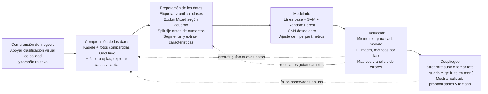

# Formulación matemática y CRISP-DM

> Borrador para el informe. Completar o ajustar los valores de partición, resultados y nombres de modelos con las decisiones y artefactos finales del equipo. No se deben inventar métricas.

## Formulación del problema

El sistema recibe una fotografía RGB `x` que contiene una sola fruta y el tipo de fruta `f`, elegido por el usuario en la interfaz. Produce dos salidas: (1) una categoría de calidad `y` —mala, regular o buena— con sus probabilidades estimadas y (2) un tamaño relativo `z` —pequeño, mediano o grande—. El tipo de fruta se selecciona en el menú; el sistema no pretende reconocer la especie automáticamente.

Sea `x ∈ [0,255]^(H×W×3)` una imagen y `S(x)` la máscara binaria estimada por el proceso de segmentación. A partir de los píxeles segmentados se calcula un vector de 69 características:

$$
\phi(x,S(x)) = [\phi_{HSV},\,\phi_{LBP},\,\phi_{forma}] \in \mathbb{R}^{69}.
$$

El vector reúne histogramas y estadísticas de color HSV, un histograma LBP de textura y medidas geométricas de la máscara. Para calidad, dado un conjunto de entrenamiento `D_train = {(x_i,y_i)}`, se aprende un clasificador `h_θ` que estima una probabilidad por clase:

$$
\hat{p}_θ(y=k\mid x) = h_θ(\phi(x,S(x)))_k,\qquad
\hat{y} = \arg\max_{k\in\{\text{mala, regular, buena}\}} \hat{p}_θ(y=k\mid x).
$$

La salida de tamaño se calcula a partir del área `A(x)` de la máscara. El diámetro equivalente normalizado es:

$$
d(x)=\frac{2\sqrt{A(x)/\pi}}{\max(H,W)}.
$$

Para cada tipo `f`, se calibran dos umbrales `t_{f,1}` y `t_{f,2}` con los percentiles 33,3 y 66,7 de los diámetros de las imágenes de entrenamiento de esa fruta. La predicción es:

$$
\hat{z}(x,f)=
\begin{cases}
\text{pequeño}, & d(x)<t_{f,1},\\
\text{mediano}, & t_{f,1}\le d(x)<t_{f,2},\\
\text{grande}, & d(x)\ge t_{f,2}.
\end{cases}
$$

Este tamaño es relativo al encuadre y a las frutas de referencia del mismo tipo; no es una medición física en centímetros. La distancia de captura debe mantenerse aproximadamente constante. Los umbrales se calculan solo con entrenamiento para evitar usar el conjunto de prueba durante la calibración.

## Estrategia y evaluación

Se compararán una línea base y dos clasificadores clásicos, por ejemplo SVM y Random Forest. La búsqueda de hiperparámetros se realiza únicamente dentro de entrenamiento mediante validación cruzada. Se seleccionan los hiperparámetros `λ` que maximizan el F1 macro promedio:

$$
\lambda^*=\arg\max_{\lambda\in\Lambda}\frac{1}{K}\sum_{j=1}^{K}
F1_{macro}(y_j,\hat{y}_{j,\lambda}).
$$

El F1 macro da el mismo peso a cada clase, por lo que ayuda cuando hay desbalance. La comparación final se hace una sola vez sobre el mismo conjunto de prueba para todos los modelos e incluye accuracy, F1 macro, precisión y recall por clase y matriz de confusión. También se reportan resultados por fuente de imágenes si el split compartido conserva esa información. La CNN de Alejo se añade a esa comparación con las mismas etiquetas y partición.

Para que la interfaz muestre probabilidades del SVM, su entrenamiento debe habilitar `probability=True` o calibrar el clasificador con `CalibratedClassifierCV`; no se debe presentar como probabilidad una puntuación sin calibrar.

El problema es de ingeniería porque combina imágenes con variación de iluminación, fondo, cámara, variedad de fruta y defectos; las clases pueden estar desbalanceadas; y la predicción debe integrarse en una interfaz con límites claros de uso. La segmentación puede fallar y las características visuales no reemplazan inspección sanitaria.

## Diagrama CRISP-DM del proyecto

El SVG es la versión lista para insertar en el informe. El Mermaid de abajo sirve como fuente editable.

### Qué evidencia documentar en cada fase

1. **Comprensión del negocio:** quién usaría la herramienta, qué decisión apoya y por qué la categoría de calidad y el tamaño relativo son útiles.
2. **Comprensión de los datos:** conteos por clase y fuente, imágenes representativas, desbalance, variaciones de iluminación/fondo y límites de las etiquetas.
3. **Preparación:** definición de clases, tratamiento de Mixed, fotos propias y compartidas, semilla y partición acordadas, aumento solo en entrenamiento, segmentación y características.
4. **Modelado:** línea base, SVM, Random Forest y CNN; rangos de hiperparámetros, validación cruzada y justificación matemática.
5. **Evaluación:** resultados reales en el test común, matrices de confusión, errores típicos y comparación entre fuentes. Dejar esta sección pendiente hasta entrenar y evaluar.
6. **Despliegue:** flujo de la interfaz, menú de fruta, entrada por archivo/cámara, contrato de predicción, límites, privacidad y aviso de que el tamaño es relativo.

## Confirmaciones antes de cerrar el informe

- Confirmar con Samuel el archivo de partición y sus proporciones/semilla; usar exactamente el mismo split en ML y CNN.
- Acordar el mapeo único de etiquetas entre `Bad/Regular/Good` y sus índices numéricos.
- Mantener el menú de fruta elegido por el usuario como entrada de la función de predicción y para seleccionar los umbrales de tamaño.
- Sustituir los ejemplos de modelos por los modelos que efectivamente entrenen y agregar únicamente métricas calculadas.
- Añadir referencias bibliográficas para GrabCut, LBP y los modelos; en particular, restaurar la referencia de LBP en el código y citarla en IEEE.
